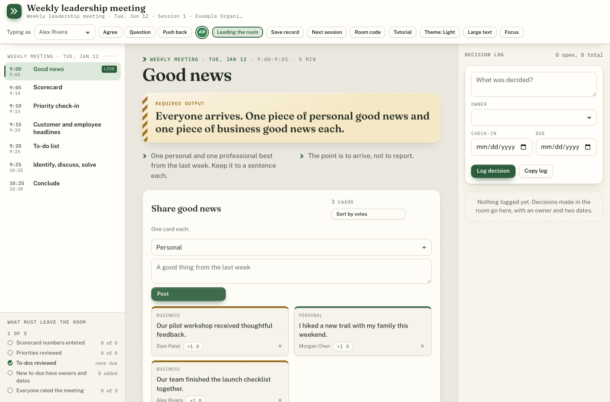
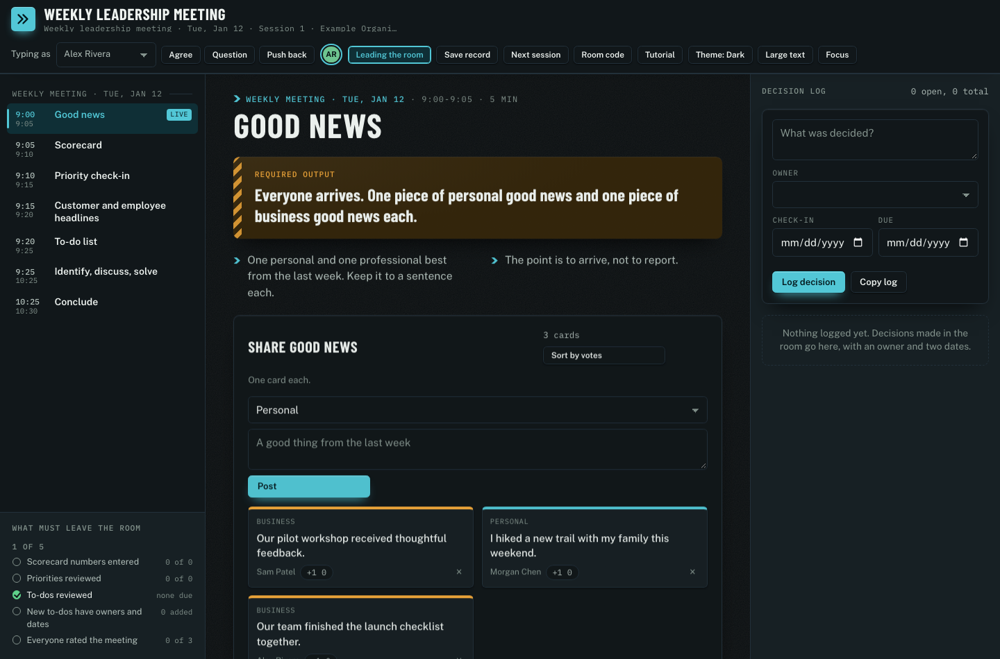
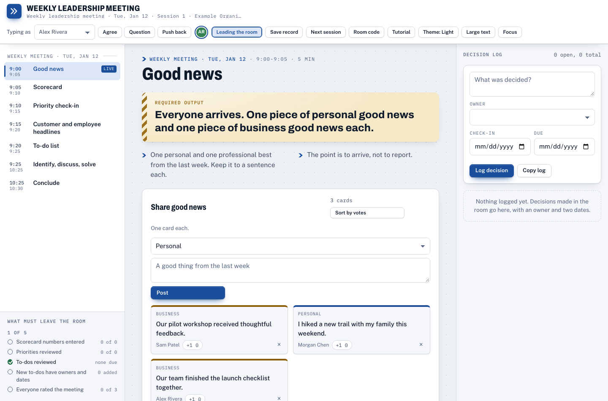

# Virtual Offsite

**Collaborative meeting rooms you can host for your own organization.**

Pick an agenda, invite your people, and work together on one shared page. Everyone can add notes, ideas, votes, decisions, and actions while a human facilitator leads the meeting. Use your usual video call alongside it.

This edition includes seven meeting templates and all three visual themes. One deployment belongs to one organization, with one shared organizer passcode and as many meeting rooms as you need. Attendees use personal links or a room code; they do not need accounts.

Free, open source, and [MIT licensed](LICENSE). You pay your own hosting, database, and optional email provider costs. This distribution contains no AI facilitator, model API calls, subscription billing, account signup, or hosted service administration.

**Want a full demo or a hosted version?** Visit [virtualoffsite.com](https://virtualoffsite.com) to explore Virtual Offsite and learn about the hosted version, including the AI facilitator. You can also [try the interactive meeting-room demo](https://www.virtualoffsite.com/demo).



## What's included

| Template | Starting agenda | Reusable room |
| --- | --- | --- |
| Quarterly planning | One day of reflection, priorities, and commitments | No |
| Annual planning | Two days of direction setting and planning | No |
| Weekly leadership | 90 minutes of numbers, headlines, actions, and issues | Yes |
| Weekly accountability | 30 minutes around one written goal and commitments | Yes |
| Daily stand-up | 15 minutes of progress, blockers, and next steps | Yes |
| Project meeting | 60 minutes of project review and decisions | Yes |
| Generic meeting | 60 minutes of flexible discussion and actions | No |

Every template can be retimed, reordered, and renamed. Add or remove agenda items, or paste an outline to build your own agenda using the included tools.

- Shared notes, idea walls and voting, boards, scorecards, issues, priorities, targets, actions, commitments, sign-off, and meeting ratings.
- **Field, Cab, and Spec** themes, each with light, dark, and automatic system mode. Attendees can change their own display.
- Personal invitations, participant presence, reactions, follow-the-presenter navigation, focus mode, and a larger screen-share view.
- Human facilitator controls, Markdown record downloads, and recurring sessions that save the previous record and carry forward the template's open work.
- Optional email invitations with calendar attachments through your own Resend account. Copy links instead if you prefer.
- First-visit tutorials for organizers, facilitators, and participants, including mobile layouts.

“Facilitator” always means a person with permission to lead the room. Templates that refer to a scribe mean a human note-taker.

## Host your own

The supported setup is **Vercel + Upstash Redis**. There are no production npm dependencies. The browser uses ordinary HTML, CSS, and JavaScript; the server uses Node.js 22 and Redis's REST API.

1. Create an Upstash Redis database dedicated to this deployment.
2. Fork this repository, then import your fork into Vercel. The included `vercel.json` supplies the build, output, routes, and function settings.
3. Add `ADMIN_PASSCODE`, `SESSION_SECRET`, `KV_REST_API_URL`, and `KV_REST_API_TOKEN` privately in Vercel's environment settings.
4. Deploy, set `BASE_URL` to the resulting site origin, and redeploy.
5. Open `/api/health`, then visit the site root and sign in with your organizer passcode.

**[Follow the complete deployment guide](docs/DEPLOY.md)** for credential generation, database connection, optional invitations, troubleshooting, and a first-meeting checklist. Keep credentials out of Git and public issues. Use a separate database for development and previews.

[](https://vercel.com/new/clone?repository-url=https%3A%2F%2Fgithub.com%2Fdsskaggs-ai%2Fvirtual-offsite&env=ADMIN_PASSCODE,SESSION_SECRET,KV_REST_API_URL,KV_REST_API_TOKEN&envDescription=Private%20organizer%20credentials%20and%20your%20dedicated%20Redis%20REST%20connection&envLink=https%3A%2F%2Fgithub.com%2Fdsskaggs-ai%2Fvirtual-offsite%2Fblob%2Fmain%2Fdocs%2FDEPLOY.md)

The button creates your own copy and asks for the four required values. Finish the `BASE_URL` and access checks in the guide afterward.

## Run a meeting

1. Open your deployment and enter the organizer passcode.
2. Select **Set up a new meeting**. Choose the template, dates, time zone, agenda, people, and look.
3. Mark at least one person as a facilitator. Share each person's private link, or send invitations if email is configured.
4. Open a separate video call and share the meeting stage. Everyone can type from their own browser.
5. Choose **Save record** to download the room's current Markdown record. In a recurring room, **Next session** also stores the previous record on the server before carrying open work forward. Stored records are available under **Manage** in the organizer console.

Personal links are credentials. Share each only with its intended attendee. Anyone with the room code can join as a participant by entering a name.

## Three looks, light or dark

| Field | Cab | Spec |
| --- | --- | --- |
|  |  |  |

These screenshots use synthetic meeting data. All six light/dark combinations are included. See the [organizer console](docs/images/organizer.png) and [phone view](docs/images/mobile.png) too.

## Local development

Install Node.js 22 and Python 3, then:

```sh
git clone https://github.com/dsskaggs-ai/virtual-offsite.git
cd virtual-offsite
npm ci
cp .env.example .env
```

Fill in your **development** Redis connection and your own passcode/session secret in the ignored `.env` file. Use `BASE_URL=http://localhost:3000`, leave optional email variables empty, then:

```sh
npm run build
npm run dev
```

Open `http://localhost:3000`. The local server binds to your computer only. For a publicly accessible installation, use HTTPS and a proper hosting setup; the included local server is a development adapter.

To run all automated checks without external credentials:

```sh
npx playwright install chromium
npm test
```

The suite runs against an isolated in-memory Redis REST fixture and a mock email service. It checks organizer access, room isolation, participant permissions, links, invitations, all seven templates across all six theme combinations, collaborative tools, recurring sessions, records, tutorials, and the public edition's feature boundaries. Theme contrast is checked separately as part of the same command. It does not send real mail or use a paid database.

## Customize and contribute

- [Deployment and operation](docs/DEPLOY.md)
- [Write a meeting template](docs/TEMPLATES.md)
- [Edit themes and contrast](docs/LOOKS.md)
- [Contribution guide](CONTRIBUTING.md)
- [Security and data handling](SECURITY.md)

Edit source in `src/` and server code in `api/`. Run `npm run build` after UI changes and commit the generated `parts/` with them. The Vercel build verifies these committed parts, so cloud deployment does not require Python. GitHub Actions runs the full tests and checks that generated parts match their source.

Your deployment stores room contents, attendee names and emails, invite tokens, and saved records in your Redis database. There is no application analytics service or publisher-controlled backend. Hosting and database providers still process requests, and Google Fonts receives font requests unless you remove the font links. Optional invitation emails go to Resend. Read [SECURITY.md](SECURITY.md) before inviting people.

Meeting templates are practical starting points. References to established planning frameworks do not imply endorsement or affiliation with their creators.
